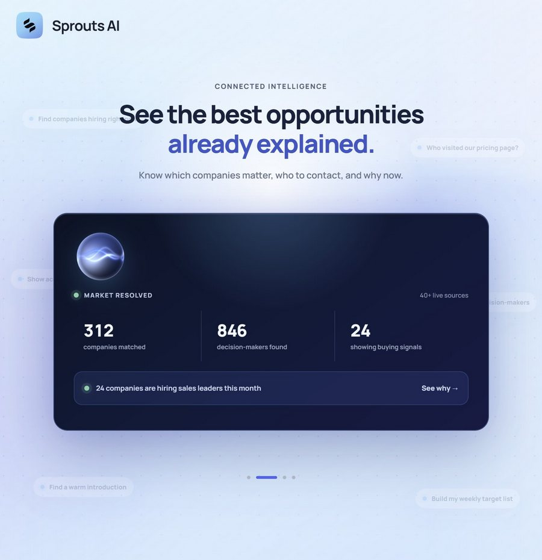
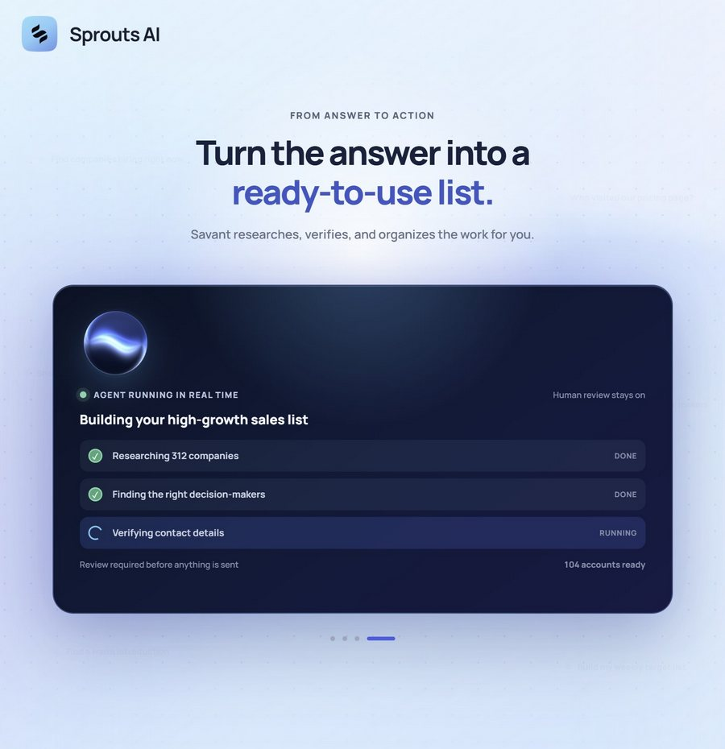

# Sprouts for desktop

### Describe the customers you want to reach. Savant finds them.

Sprouts on Windows and Mac, in its own window, one click from your taskbar or dock.

&nbsp;

Windows 10 and 11 (64-bit) · Sign in with your Sprouts account · Updates itself

 

## What you can do with Sprouts

<table>
<tr>
<td width="50%" valign="top">

**Start with a question**

Type what you're looking for the way you'd say it: "Find companies hiring right now" or "Who visited our pricing page?" Savant turns it into a precise market.

</td>
<td width="50%" valign="top">

**See the best opportunities, already explained**

Know which companies matter, who to contact, and why now. Savant shows the companies that match, the decision-makers inside them, and the ones showing buying signals.

</td>
</tr>
<tr>
<td width="50%" valign="top">

**Understand every account before you reach out**

Savant pulls company context, people and signals into one brief, with the stakeholders mapped and the warm paths in.

</td>
<td width="50%" valign="top">

**Turn the answer into a ready-to-use list**

Savant researches the companies, finds the right decision-makers and verifies their contact details. Nothing goes out until you've reviewed it.

</td>
</tr>
</table>

## Why use the desktop app

If Sprouts is open most of your day, the app saves you from hunting through browser tabs for it.

- Sprouts sits in your taskbar or dock, one click away.
- Closing the window keeps Sprouts running in the system tray on Windows, or in the dock on a Mac. Click it and you're back on the page you left.
- You sign in once. Google, Microsoft, your company's single sign-on and email sign-in all work, and you stay signed in.
- Savant voice works in the app. It asks for your microphone the first time you use it, and never for your camera.
- New features arrive on their own. Changes to Sprouts show up in the app as soon as they reach the web version, and the app installs its own updates in the background.

## Install

### Windows

1. Download [Sprouts-Setup-Windows.exe](https://github.com/kartikaydhar7/sprouts-desktop-releases/releases/latest/download/Sprouts-Setup-Windows.exe).
2. Open it. Sprouts installs for your user account, so you don't need admin rights, and opens when it's done.
3. Sign in with your Sprouts account.

If Windows shows "Windows protected your PC", click **More info**, then **Run anyway**. You'll stop seeing this once the installer is code-signed.

### Mac

The Mac version is being signed and notarized with Apple so it opens without security warnings. Its download will appear here when that's done.

## Questions

**Is this a different product from Sprouts on the web?**
No. It's the same Sprouts you use at [app.sprouts.ai](https://app.sprouts.ai), with the same account and the same data. The desktop app gives it a window and icon of its own, keeps it running when you close the window, and updates itself.

**Do I have to update it?**
No. The app checks for updates when it starts and every few hours after that. It downloads them in the background and asks you to restart when one is ready. If you'd rather not restart, the update installs the next time you quit.

**How do I uninstall it?**
On Windows, open Settings, go to Apps, find Sprouts and choose Uninstall. On a Mac, drag Sprouts from Applications to the Trash.

**Where are older versions?**
On the [releases page](https://github.com/kartikaydhar7/sprouts-desktop-releases/releases). Each release also carries the files the app uses to update itself (`latest.yml` and `.blockmap`), which you can ignore.

 

Prefer the browser? Sprouts is always at <a href="https://app.sprouts.ai">app.sprouts.ai</a>. This repository hosts the installers and update feed for the Sprouts desktop app.

