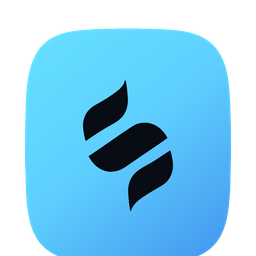
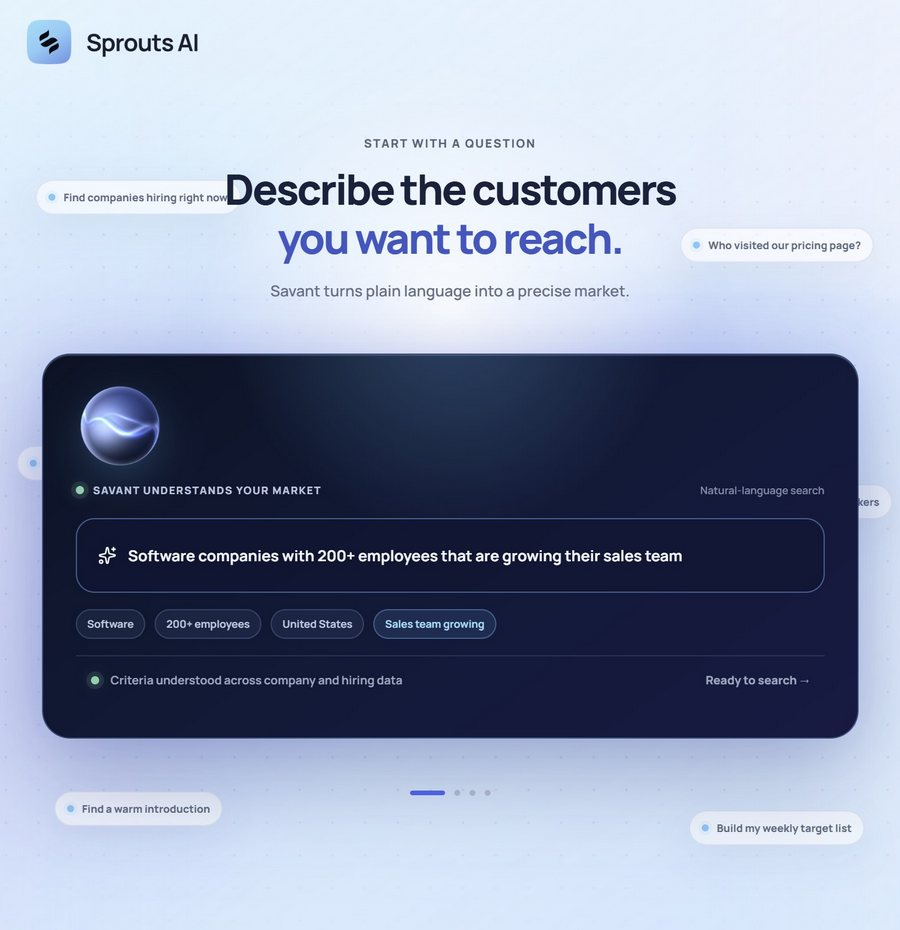
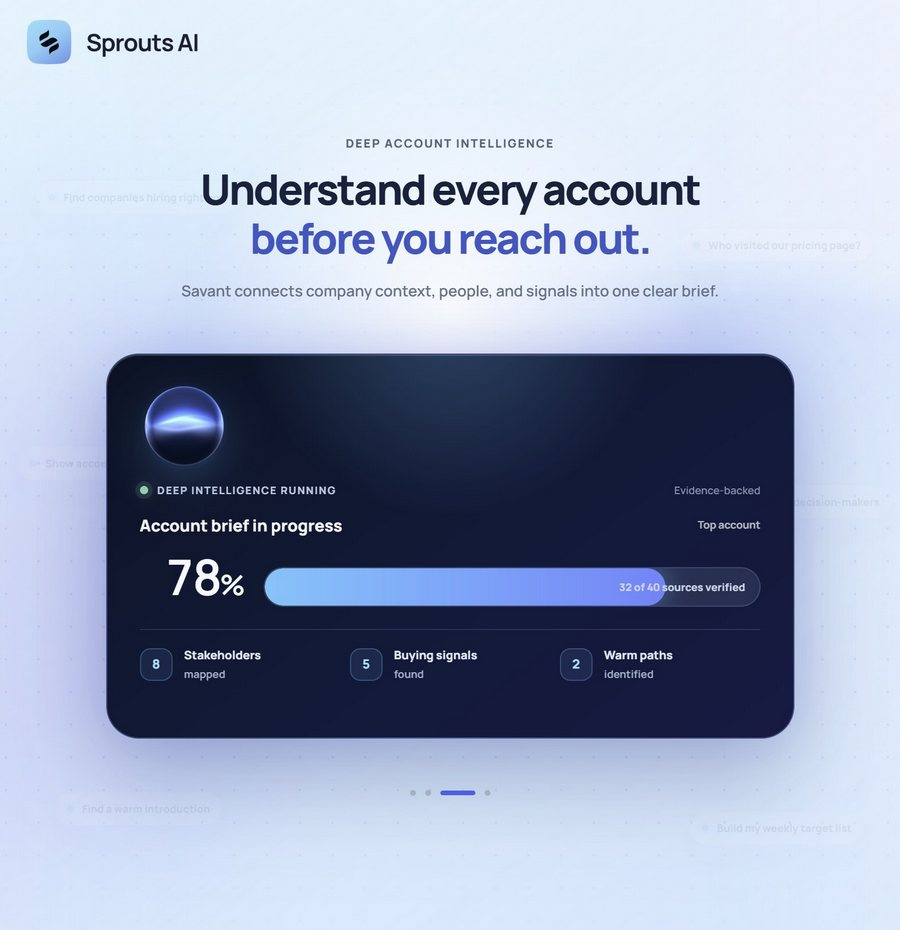

# Sprouts for desktop

### Describe the customers you want to reach. Savant finds them.

Sprouts as an app on your computer, one click from your taskbar or dock.

&nbsp;

Works on Windows 10 and 11, and on Macs with Intel or Apple chips · Same login as Sprouts on the web

 

## What you can do with Sprouts

<table>
<tr>
<td width="50%" valign="top">

**Start with a question**

Ask for the companies you want in plain words, like "Find companies hiring right now" or "Who visited our pricing page?" Savant turns it into a precise market.

</td>
<td width="50%" valign="top">

**See the best opportunities, already explained**

See which companies matter, who to contact there, and why now. Savant flags the companies showing buying signals.

</td>
</tr>
<tr>
<td width="50%" valign="top">

**Understand every account before you reach out**

Savant puts company context, people and signals into one brief for each account, with the stakeholders mapped and warm paths in.

</td>
<td width="50%" valign="top">

**Turn the answer into a ready-to-use list**

Savant researches the companies, finds the right decision-makers and checks their contact details. Nothing goes out until you've reviewed it.

</td>
</tr>
</table>

## Why get the desktop app

If you work in Sprouts most of the day, the app keeps it one click away, out of your browser tabs.

- Close the window and Sprouts keeps running. Click the icon and you're back where you left off.
- Ask Savant out loud. The app uses your microphone only for Savant voice, and never uses your camera.
- Sprouts keeps itself up to date. New features show up as soon as they launch, and app updates install in the background.

## Get started

### On Windows

1. Click **Download for Windows** at the top of this page.
2. Open the file you downloaded. Sprouts installs and opens by itself, and you won't need an admin password.
3. Sign in the way you normally do: Google, Microsoft, your company login or email.

If a blue "Windows protected your PC" box appears, click **More info**, then **Run anyway**.

### On a Mac

1. Click **Download for Mac** at the top of this page.
2. Open the file you downloaded and drag Sprouts into your Applications folder.
3. Open Sprouts from Applications and sign in the way you normally do.

## Questions

**Is this the same Sprouts I use in my browser?**
Yes. You sign in with the same login and see the same accounts, lists and searches. Anything you do in the app also shows up in Sprouts on the web.

**Do I need to update it?**
No. Sprouts updates itself. When a new version is ready, it asks you to restart, or it updates the next time you quit.

**How do I remove it?**
On Windows, open Settings, then Apps, find Sprouts and click Uninstall. On a Mac, drag Sprouts from Applications to the Trash.

 

Prefer your browser? Sprouts is always at <a href="https://app.sprouts.ai">app.sprouts.ai</a>.

